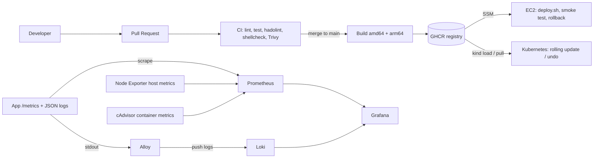

# DevOps Assessment – Simple Web Service

A small Node.js service that is containerized, tested in CI, deployed with Terraform/Kubernetes, and monitored with Prometheus, Grafana, Loki, Alloy, Node Exporter and cAdvisor.

> **Honest scope note:** I do not have an AWS account. Everything runs locally (Docker, kind, LocalStack). The GitHub Actions deploy job to EC2 is written but was **not run against real AWS**. See [Evidence and limitations](#evidence-and-limitations).

## Repository layout

```
app/                 Node.js service, tests, multi-stage Dockerfile
docker-compose.yml   app (+ monitoring stack with --profile monitoring)
monitoring/          Prometheus, Loki, Alloy, Grafana provisioning + 3 dashboards
k8s/                 Kubernetes manifests (kind)
terraform/           EC2, security group, IAM, CloudWatch log group
scripts/             system_health.sh, deploy.sh (with rollback), systemd/cron files
.github/workflows/   pr.yml and main.yml
docs/                screenshots and evidence
```

## 1. Prerequisites and running locally

Needs: Docker + Docker Compose v2, Node 20 (only for running tests outside Docker), `kind`, `kubectl`, `terraform` (>= 1.10), `shellcheck`.

**App only**
```bash
docker compose up -d --build
curl localhost:8080/          # {"message":"Hello from DevOps Task!","status":"running","version":"1.0.0"}
curl localhost:8080/health
curl localhost:8080/metrics
```

**App + monitoring stack**
```bash
cp .env.example .env          # set your own Grafana password
docker compose --profile monitoring up -d --build
```
Open Grafana at http://localhost:3000 (login from `.env`). The three dashboards are in the folder **DevOps Task**. Only Grafana (3000) and the app (8080) are published to the host. The other containers talk over the internal Compose network.

Generate some traffic (including errors):
```bash
for i in $(seq 100); do curl -s localhost:8080/ >/dev/null; curl -s localhost:8080/error >/dev/null; done
```

Stop everything: `docker compose --profile monitoring down`

## 2. Running tests, health script, Terraform and Kubernetes

**Tests and lint**
```bash
cd app && npm ci && npm run lint && npm test
```

**Health script**
```bash
./scripts/system_health.sh --help
./scripts/system_health.sh                       # text log line
./scripts/system_health.sh --json --disk 80 --cpu 90 --mem 85
echo $?                                          # 0 healthy, 1 warning, 2 critical
shellcheck scripts/*.sh
```
Run every 5 minutes with systemd (`scripts/system-health.service` + `.timer`) or cron (`scripts/health.cron`). The log (`health_log.txt`) rotates to `health_log.txt.1` when it passes 1 MB.

**Terraform** (no AWS account: LocalStack)
```bash
docker run -d --name localstack -p 4566:4566 localstack/localstack:3.8
cd terraform
terraform init -backend=false
terraform fmt -check && terraform validate
terraform plan  -var-file=envs/staging.tfvars -var-file=envs/localstack.tfvars
terraform apply -var-file=envs/staging.tfvars -var-file=envs/localstack.tfvars
terraform destroy -var-file=envs/staging.tfvars -var-file=envs/localstack.tfvars
```
With a real AWS account: edit the bucket in `backend.tf`, then `terraform init -backend-config="key=staging/terraform.tfstate"` and run plan/apply with only `envs/staging.tfvars` (or `prod.tfvars`). The same code builds both environments through variables.

**Kubernetes (kind)**
```bash
kind create cluster --name devops
docker build -t devops-task:1.0.0 app/
docker build --build-arg APP_VERSION=2.0.0 -t devops-task:2.0.0 app/
kind load docker-image devops-task:1.0.0 devops-task:2.0.0 --name devops

# metrics-server (needed by the HPA; --kubelet-insecure-tls is needed on kind)
kubectl apply -f https://github.com/kubernetes-sigs/metrics-server/releases/latest/download/components.yaml
kubectl -n kube-system patch deployment metrics-server --type=json \
  -p='[{"op":"add","path":"/spec/template/spec/containers/0/args/-","value":"--kubelet-insecure-tls"}]'

# optional secret (enter the value silently; never commit it to git)
read -rsp "EXAMPLE_API_KEY: " EXAMPLE_API_KEY; printf '\n'
kubectl create secret generic devops-task-secret --from-literal="EXAMPLE_API_KEY=$EXAMPLE_API_KEY"
unset EXAMPLE_API_KEY

kubectl apply -f k8s/
kubectl rollout status deployment/devops-task
kubectl port-forward svc/devops-task 8081:80      # port-forward alternative to the Ingress
```

### Zero-downtime rolling update and rollback

The probe sends 200 requests through the Kubernetes Service while the Deployment updates. `maxUnavailable: 0` keeps old pods available until replacements pass readiness checks.

```bash
kubectl delete pod rollout-probe --ignore-not-found
kubectl run rollout-probe --image=curlimages/curl:8.10.1 --restart=Never --command -- sh -c '
i=0
failures=0
while [ "$i" -lt 200 ]; do
  code=$(curl -sS --max-time 2 -o /dev/null -w "%{http_code}" http://devops-task/health 2>/dev/null || printf "000")
  if [ "$code" != "200" ]; then echo "failed status=$code"; failures=$((failures+1)); fi
  i=$((i+1))
  sleep 0.1
done
echo "requests=$i failures=$failures"
'
kubectl wait --for=condition=Ready pod/rollout-probe --timeout=90s
kubectl set image deployment/devops-task app=devops-task:2.0.0
kubectl rollout status deployment/devops-task
kubectl logs rollout-probe
kubectl rollout undo deployment/devops-task
kubectl rollout status deployment/devops-task
kubectl get deployment devops-task -o jsonpath='{.spec.template.spec.containers[0].image}{"\n"}'
kubectl delete pod rollout-probe
```

```
pod/rollout-probe created
pod/rollout-probe condition met
deployment.apps/devops-task image updated
deployment "devops-task" successfully rolled out
requests=200 failures=0
deployment.apps/devops-task rolled back
deployment "devops-task" successfully rolled out
devops-task:1.0.0
```

### Secrets in Kubernetes
Secrets are **not** committed. The Deployment reads `devops-task-secret` as an optional `secretRef`; it is created with `kubectl create secret` (command above). In production I would use External Secrets Operator with AWS Secrets Manager.

### What changes on EKS
- **Ingress:** AWS Load Balancer Controller (ALB) instead of port-forward / kind ingress.
- **Secrets:** External Secrets Operator or the Secrets Store CSI driver with AWS Secrets Manager.
- **Scaling nodes:** Karpenter or Cluster Autoscaler, on top of the HPA for pods.
- **AWS permissions:** IAM Roles for Service Accounts (IRSA) per workload, no node-wide permissions.
- **Images:** pull from ECR; manage the cluster with Terraform.

## 3. Architecture



## 4. Design decisions

- **Node.js + Express:** small, familiar, easy to test. `prom-client` for metrics, `pino` for JSON logs.
- **Multi-stage Dockerfile on Alpine:** stage 1 installs production dependencies, stage 2 copies only the result. Alpine (not distroless) keeps `wget` for a simple `HEALTHCHECK` and a shell for debugging, at the cost of a slightly bigger image than distroless. Base image pinned to `node:20.18.1-alpine3.20`. Runs as the non-root `node` user.
- **EC2 vs ECS vs EKS:** one small service, so one EC2 instance with Docker is the cheapest and simplest. ECS/EKS only pay off with many services or autoscaling needs.
- **Tagging:** every image gets the full git SHA (exact traceability) and a version `1.0.<run number>` (readable). `latest` is never used, so a rollback always points to a specific tag.
- **Secrets:** no secrets in git. CI uses `GITHUB_TOKEN` for GHCR and GitHub Actions secrets for AWS deploy credentials. Grafana password from `.env` (git-ignored). Kubernetes secret created by command.
- **No SSH on EC2:** deploys go through SSM, so the security group only opens port 8080.
- **Loki labels:** only `service`, `container` and `level`. These have few distinct values. `path` and `status` have many values and would make the index large, so they are not labels; filter them at query time with `| json | path="/error"`.
- **Single compose file with a profile:** `docker compose up` runs only the app; `--profile monitoring` adds the stack.

### Why Alloy and cAdvisor?
- **Alloy** reads the logs of all Docker containers and ships them to Loki. Loki does not collect logs by itself.
- **cAdvisor** gives per-container CPU and memory. Node Exporter only sees the host, not individual containers.

### Monitoring stack hygiene
- All image versions are pinned. Prometheus retention 15 days, Loki retention 7 days.
- **Privileges granted (read-only everywhere):**
  - Node Exporter: `pid: host` and `/` mounted read-only at `/host`, to read host CPU, memory, disk and network.
  - cAdvisor: `/`, `/var/run`, `/sys`, `/var/lib/docker` read-only, to read container cgroup data.
  - Alloy: `/var/run/docker.sock` read-only, to discover containers and read their logs. (Docker socket access is powerful, so this is the biggest trade-off; acceptable locally.)

### Alerts and thresholds

| Alert | Rule | For | Why |
|---|---|---|---|
| AppDown | `up{job="app"} == 0` | 1m | Short enough to react fast, long enough to ignore one failed scrape |
| HighErrorRate | 5xx / all requests > 5% | 5m | A few errors are normal; 5 minutes avoids alerting on a short blip |
| HostDiskUsageHigh | disk used > 80% | 10m | Disks fill slowly, so a long window avoids noise and 80% leaves time to act |
| ContainerMemoryNearLimit | memory > 90% of limit | 5m | Above 90% an OOM kill is close; 5 minutes ignores short spikes |

## 5. "An error spike appears on the Application dashboard. How do I find the cause?"

1. The **error rate** panel jumps (or the `HighErrorRate` alert fires in Prometheus).
2. On the same dashboard, look at the **App error logs (Loki)** panel next to it. It shows `level="error"` lines for the same time range.
3. Use the second logs panel with `| json | path="/error"` (or any path) to see which endpoint fails and its status code.
4. Check the **latency** panel: errors with high latency suggest a slow dependency; errors with normal latency suggest a code bug.
5. Open the **Containers** dashboard: is memory near the limit, or did CPU spike? That points to resource problems.
6. Open the **Host** dashboard to rule out a full disk or CPU saturation on the host.
7. If a new release caused it, roll back (see below).

## 6. Deployment and rollback strategy

1. Developer opens a PR. CI runs lint, tests, hadolint, shellcheck and the Trivy scan (fails on CRITICAL).
2. After review and merge to `main`, CI builds a multi-arch image, tags it with SHA + version and pushes to GHCR.
3. The deploy job runs `scripts/deploy.sh <image>` on the EC2 instance through SSM. The script pulls the image, starts it, and calls `/health` for up to 30 seconds.
4. **If `/health` fails**, the script removes the new container and restarts the **previous image tag**, then exits with an error so the pipeline fails.
5. Manual rollback: run `deploy.sh` again with an older tag. Kubernetes: `kubectl rollout undo`.

Required GitHub settings (only for the EC2 deploy job):

| Type | Name | Purpose |
|---|---|---|
| Variable | `AWS_DEPLOY_ENABLED` | Set to `true` to enable the deploy job after configuring credentials |
| Variable | `AWS_REGION` | AWS region |
| Variable | `EC2_INSTANCE_ID` | Target instance (Terraform output `instance_id`) |
| Secret | `AWS_ACCESS_KEY_ID` | Access key for a dedicated IAM deploy user |
| Secret | `AWS_SECRET_ACCESS_KEY` | Secret key for that IAM user |

Grant the IAM user only the SSM permissions needed to send the deploy command to this instance and read its command result. Store both keys as repository secrets, then set `AWS_DEPLOY_ENABLED` to `true`. Environment-scoped secrets require adding that environment to the deploy job. These are long-lived credentials, so restrict their permissions and rotate them regularly.

The GHCR package must be public (or the instance needs a pull token) so the instance can pull it.

## 7. Security considerations

- **Secrets:** AWS deploy keys are stored in GitHub Actions secrets, not in git; `.env` ignored; k8s secret created out-of-band. Restrict and rotate the long-lived AWS keys.
- **Image scanning:** Trivy on every PR, pipeline fails on CRITICAL. Image runs as non-root; k8s uses a read-only root filesystem, dropped capabilities and no privilege escalation.
- **IAM:** the instance role only has SSM core access and permission to write to its own single log group. No static keys. IMDSv2 required.
- **Network:** security group opens only 8080, no SSH. Monitoring ports are not published; only Grafana is.

## 8. Rough monthly AWS cost (production, one instance, us-east-1)

| Item | Approx. |
|---|---|
| EC2 `t3.small` (on demand) | $15 |
| 20 GB gp3 disk | $2 |
| Public IPv4 address | $4 |
| CloudWatch Logs (small volume) | $2 |
| Data transfer | $2–5 |
| **Total** | **~$25–30 / month** |

Estimate only; check with the AWS Pricing Calculator.

## 9. What I would improve with more time

- Deploy to a real AWS account and attach the workflow logs as evidence.
- Alertmanager with Slack/Discord routing.
- Image signing (Cosign) and SBOM in CI.
- Helm chart with staging/prod values.
- Put the Terraform state bucket itself in code and add a prod approval step in the pipeline.

## AI usage

> TODO: edit this to be true for you. Example: "I used an AI assistant (Claude) to plan the structure and draft configuration files. I ran the tests, read and understood every file, and can explain each part."

## Evidence and limitations

- Tests and lint pass locally (4 tests, coverage in the CI log).
- `shellcheck scripts/*.sh` reports no warnings.
- Not verified against real AWS: the EC2 `user_data` run, SSM deploy, CloudWatch log delivery.
- Terraform tested with `validate` and with `plan`/`apply` against LocalStack (outputs in `docs/evidence/`), not real AWS.
- Final image size: **TODO – run `docker images devops-task` and write it here.**
- Screenshots (put files in `docs/screenshots/` and link them here):
  - ``
  - ``
  - ``
